# Untitled Diagram documentation
## Summary

- [Introduction](#introduction)
- [Database Type](#database-type)
- [Table Structure](#table-structure)
	- [Bronze_Ports](#bronze_ports)
	- [Bronze_Vessels](#bronze_vessels)
	- [Bronze_Seismic](#bronze_seismic)
	- [Silver_Ports](#silver_ports)
	- [Silver_Vessels](#silver_vessels)
	- [Silver_Seismic](#silver_seismic)
	- [Dim_Date](#dim_date)
	- [Dim_Time](#dim_time)
	- [Dim_Ports](#dim_ports)
	- [Gold_Vessels](#gold_vessels)
	- [Gold_Seismic](#gold_seismic)
- [Relationships](#relationships)
- [Database Diagram](#database-diagram)

## Database Diagram

```mermaid
erDiagram
	Dim_Date ||--o{ Gold_Seismic : references
	Dim_Time ||--o{ Gold_Seismic : references
	Dim_Date ||--o{ Dim_Ports : references
	Dim_Time ||--o{ Dim_Ports : references
	Dim_Time ||--o{ Gold_Vessels : references
	Dim_Date ||--o{ Gold_Vessels : references

	Bronze_Ports {
		INTEGER OID_
		INTEGER World_Port_Index_Number
		VARCHAR(255) Region_Name
		VARCHAR(255) Main_Port_Name
		VARCHAR(255) Alternate_Port_Name
		VARCHAR(255) UN_LOCODE
		VARCHAR(255) Country_Code
		VARCHAR(255) World_Water_Body
		VARCHAR(255) IHO_S_130_Sea_Area
		VARCHAR(255) Sailing_Direction_or_Publication
		VARCHAR(255) Publication_Link
		VARCHAR(255) Standard_Nautical_Chart
		VARCHAR(255) IHO_S_57_Electronic_Navigational_Chart
		VARCHAR(255) IHO_S_101_Electronic_Navigational_Chart
		VARCHAR(255) Digital_Nautical_Chart
		DECIMAL Tidal_Range_m_
		DECIMAL Entrance_Width_m_
		DECIMAL Channel_Depth_m_
		DECIMAL Anchorage_Depth_m_
		DECIMAL Cargo_Pier_Depth_m_
		DECIMAL Oil_Terminal_Depth_m_
		DECIMAL Liquified_Natural_Gas_Terminal_Depth_m_
		DECIMAL Maximum_Vessel_Length_m_
		DECIMAL Maximum_Vessel_Beam_m_
		DECIMAL Maximum_Vessel_Draft_m_
		DECIMAL Offshore_Maximum_Vessel_Length_m_
		DECIMAL Offshore_Maximum_Vessel_Beam_m_
		DECIMAL Offshore_Maximum_Vessel_Draft_m_
		VARCHAR(255) Harbor_Size
		VARCHAR(255) Harbor_Type
		VARCHAR(255) Harbor_Use
		VARCHAR(255) Shelter_Afforded
		VARCHAR(255) Entrance_Restriction_Tide
		VARCHAR(255) Entrance_Restriction_Heavy_Swell
		VARCHAR(255) Entrance_Restriction_Ice
		VARCHAR(255) Entrance_Restriction_Other
		VARCHAR(255) Overhead_Limits
		VARCHAR(255) Underkeel_Clearance_Management_System
		VARCHAR(255) Good_Holding_Ground
		VARCHAR(255) Turning_Area
		VARCHAR(255) Port_Security
		VARCHAR(255) Estimated_Time_of_Arrival_Message
		VARCHAR(255) Quarantine_Pratique
		VARCHAR(255) Quarantine_Sanitation
		VARCHAR(255) Quarantine_Other
		VARCHAR(255) Traffic_Separation_Scheme
		VARCHAR(255) Vessel_Traffic_Service
		VARCHAR(255) First_Port_of_Entry
		VARCHAR(255) US_Representative
		VARCHAR(255) Pilotage_Compulsory
		VARCHAR(255) Pilotage_Available
		VARCHAR(255) Pilotage_Local_Assistance
		VARCHAR(255) Pilotage_Advisable
		VARCHAR(255) Tugs_Salvage
		VARCHAR(255) Tugs_Assistance
		VARCHAR(255) Communications_Telephone
		VARCHAR(255) Communications_Telefax
		VARCHAR(255) Communications_Radio
		VARCHAR(255) Communications_Radiotelephone
		VARCHAR(255) Communications_Airport
		VARCHAR(255) Communications_Rail
		VARCHAR(255) Search_and_Rescue
		VARCHAR(255) NAVAREA
		VARCHAR(255) Facilities_Wharves
		VARCHAR(255) Facilities_Anchorage
		VARCHAR(255) Facilities_Dangerous_Cargo_Anchorage
		VARCHAR(255) Facilities_Med_Mooring
		VARCHAR(255) Facilities_Beach_Mooring
		VARCHAR(255) Facilities_Ice_Mooring
		VARCHAR(255) Facilities_Ro_Ro
		VARCHAR(255) Facilities_Solid_Bulk
		VARCHAR(255) Facilities_Liquid_Bulk
		VARCHAR(255) Facilities_Container
		VARCHAR(255) Facilities_Breakbulk
		VARCHAR(255) Facilities_Oil_Terminal
		VARCHAR(255) Facilities_LNG_Terminal
		VARCHAR(255) Facilities_Other
		VARCHAR(255) Medical_Facilities
		VARCHAR(255) Garbage_Disposal
		VARCHAR(255) Chemical_Holding_Tank_Disposal
		VARCHAR(255) Degaussing
		VARCHAR(255) Dirty_Ballast_Disposal
		VARCHAR(255) Cranes_Fixed
		VARCHAR(255) Cranes_Mobile
		VARCHAR(255) Cranes_Floating
		VARCHAR(255) Cranes_Container
		VARCHAR(255) Lifts_100_Tons
		VARCHAR(255) Lifts_50_100_Tons
		VARCHAR(255) Lifts_25_49_Tons
		VARCHAR(255) Lifts_0_24_Tons
		VARCHAR(255) Services_Longshoremen
		VARCHAR(255) Services_Electricity
		VARCHAR(255) Services_Steam
		VARCHAR(255) Services_Navigation_Equipment
		VARCHAR(255) Services_Electrical_Repair
		VARCHAR(255) Services_Ice_Breaking
		VARCHAR(255) Services_Diving
		VARCHAR(255) Supplies_Provisions
		VARCHAR(255) Supplies_Potable_Water
		VARCHAR(255) Supplies_Fuel_Oil
		VARCHAR(255) Supplies_Diesel_Oil
		VARCHAR(255) Supplies_Aviation_Fuel
		VARCHAR(255) Supplies_Deck
		VARCHAR(255) Supplies_Engine
		VARCHAR(255) Repairs
		VARCHAR(255) Dry_Dock
		VARCHAR(255) Railway
		DECIMAL Latitude
		DECIMAL Longitude
		VARCHAR(255) source_name
		TIMESTAMP Ingested_at
	}

	Silver_Ports {
		INTEGER OID_
		INTEGER World_Port_Index_Number
		VARCHAR(255) Region_Name
		VARCHAR(255) Main_Port_Name
		VARCHAR(255) Alternate_Port_Name
		VARCHAR(255) UN_LOCODE
		VARCHAR(255) Country_Code
		VARCHAR(255) World_Water_Body
		VARCHAR(255) Sailing_Direction_or_Publication
		DECIMAL Tidal_Range_m_
		DECIMAL Entrance_Width_m_
		DECIMAL Channel_Depth_m_
		DECIMAL Anchorage_Depth_m_
		DECIMAL Cargo_Pier_Depth_m_
		DECIMAL Oil_Terminal_Depth_m_
		DECIMAL Liquified_Natural_Gas_Terminal_Depth_m_
		DECIMAL Maximum_Vessel_Length_m_
		DECIMAL Maximum_Vessel_Beam_m_
		DECIMAL Maximum_Vessel_Draft_m_
		DECIMAL Offshore_Maximum_Vessel_Length_m_
		DECIMAL Offshore_Maximum_Vessel_Beam_m_
		DECIMAL Offshore_Maximum_Vessel_Draft_m_
		VARCHAR(255) Harbor_Size
		VARCHAR(255) Harbor_Type
		VARCHAR(255) Harbor_Use
		VARCHAR(255) Shelter_Afforded
		CHAR(1) Entrance_Restriction_Tide
		CHAR(1) Entrance_Restriction_Heavy_Swell
		CHAR(1) Entrance_Restriction_Ice
		CHAR(1) Entrance_Restriction_Other
		CHAR(1) Communications_Telephone
		CHAR(1) Communications_Telefax
		CHAR(1) Communications_Radio
		CHAR(1) Communications_Radiotelephone
		CHAR(1) Communications_Airport
		CHAR(1) Communications_Rail
		CHAR(1) Medical_Facilities
		CHAR(1) Supplies_Provisions
		CHAR(1) Supplies_Potable_Water
		CHAR(1) Supplies_Fuel_Oil
		CHAR(1) Supplies_Diesel_Oil
		CHAR(1) Supplies_Aviation_Fuel
		CHAR(1) Supplies_Deck
		CHAR(1) Supplies_Engine
		VARCHAR(255) Repairs
		VARCHAR(255) Dry_Dock
		VARCHAR(255) Railway
		DECIMAL Latitude
		DECIMAL Longitude
		VARCHAR(255) source_name
		TIMESTAMP ingested_at
		TIMESTAMP loaded_to_silver
	}

	Bronze_Seismic {
		VARCHAR(255) unid
		INTEGER source_id
		VARCHAR(255) flynn_region
		DECIMAL lat
		DECIMAL lon
		DECIMAL depth
		DECIMAL mag
		VARCHAR(255) action
		TIMESTAMP generated_at
		VARCHAR(255) source_name
		TIMESTAMP ingested_at
	}

	Silver_Seismic {
		VARCHAR(255) unid
		INTEGER source_id
		VARCHAR(255) flynn_region
		DECIMAL latitude
		DECIMAL longitude
		DECIMAL depth
		DECIMAL magnitude
		VARCHAR(255) action
		TIMESTAMP generated_at
		VARCHAR(255) source_name
		TIMESTAMP ingested_at
		TIMESTAMP loaded_to_silver
	}

	Gold_Seismic {
		VARCHAR(255) unid
		INTEGER source_id
		VARCHAR(255) flynn_region
		DECIMAL latitude
		DECIMAL longitude
		DECIMAL depth
		DECIMAL magnitude
		VARCHAR(255) action
		TIMESTAMP generated_at
		VARCHAR(255) source_name
		TIMESTAMP ingested_at
		TIMESTAMP loaded_to_silver
		TIMESTAMP loaded_to_gold
		INTEGER date_key
		INTEGER time_key
	}

	Dim_Date {
		INTEGER date_key
		DATE full_date
		TINYINT day_num_month
		VARCHAR(255) day_name
		TINYINT day_num_week
		VARCHAR(255) day_of_week
		TINYINT day_num_year
		TINYINT month_num
		VARCHAR(255) month_name
		VARCHAR(255) month_short
	}

	Dim_Time {
		INTEGER time_key
		TIME full_time
		TINYINT hour
		TINYINT minute
		TINYINT second
	}

	Dim_Ports {
		INTEGER OID_
		INTEGER wpi_number
		VARCHAR(255) region_name
		VARCHAR(255) port_name
		VARCHAR(255) alt_port_name
		VARCHAR(255) un_locode
		VARCHAR(255) country_code
		VARCHAR(255) water_body
		VARCHAR(255) sailing_direction
		DECIMAL tidal_range_m
		DECIMAL entrance_width_m
		DECIMAL channel_depth_m
		DECIMAL anchorage_depth_m
		DECIMAL cargo_pier_depth_m
		DECIMAL oil_terminal_depth_m
		DECIMAL lpg_terminal_depth_m
		DECIMAL max_vessel_length_m
		DECIMAL max_vessel_beam_m
		DECIMAL max_vessel_draft_m
		DECIMAL offshore_max_vessel_length_m
		DECIMAL offshore_max_vessel_beam_m
		DECIMAL offshore_max_vessel_draft_m
		VARCHAR(255) harbor_size
		VARCHAR(255) harbor_type
		VARCHAR(255) harbor_use
		VARCHAR(255) has_shelter
		CHAR(1) has_communication_telephone
		CHAR(1) has_communication_telefax
		CHAR(1) has_communication_radio
		CHAR(1) has_communication_radiotelephone
		CHAR(1) has_communication_airport
		CHAR(1) has_communication_rail
		TINYINT communications_index
		VARCHAR(255) communications_index_category
		CHAR(1) has_medical_facilities
		CHAR(1) has_supplies_provisions
		CHAR(1) has_supplies_potable_water
		CHAR(1) has_supplies_fuel_oil
		CHAR(1) has_supplies_diesel_oil
		CHAR(1) has_supplies_aviation_fuel
		CHAR(1) has_supplies_deck
		CHAR(1) has_supplies_engine
		VARCHAR(255) repairs
		CHAR(1) has_repairts
		TINYINT supplies_index
		VARCHAR(255) supplies_index_category
		VARCHAR(255) dry_dock
		VARCHAR(255) railway
		DECIMAL latitude
		DECIMAL longitude
		VARCHAR(255) source_name
		TIMESTAMP ingested_at
		TIMESTAMP loaded_to_silver
		TIMESTAMP loaded_to_gold
		INTEGER date_key
		INTEGER time_key
	}

	Bronze_Vessels {
		VARCHAR(255) name
		VARCHAR(255) type
		VARCHAR(255) year_built
		VARCHAR(255) gross_tonnage
		VARCHAR(255) dead_weight
		VARCHAR(255) length_m_
		VARCHAR(255) beam_m_
		VARCHAR(255) detail_link
		TIMESTAMP departure_date
		VARCHAR(255) last_port_country
		VARCHAR(255) last_port_name
		TIMESTAMP arrival_date
		VARCHAR(255) destination_port_country
		VARCHAR(255) destination_port_name
		DECIMAL destination_port_lat
		DECIMAL destination_port_lon
		VARCHAR(255) reported_status
		TIMESTAMP report_date
		VARCHAR(255) source_name
		TIMESTAMP ingested_at
	}

	Silver_Vessels {
		VARCHAR(255) name
		VARCHAR(255) type
		INTEGER year_built
		INTEGER gross_tonnage
		INTEGER dead_weight
		INTEGER length_m_
		INTEGER beam_m_
		VARCHAR(255) detail_link
		TIMESTAMP departure_date
		VARCHAR(255) last_port_country
		VARCHAR(255) last_port_name
		TIMESTAMP arrival_date
		VARCHAR(255) destination_port_country
		VARCHAR(255) destination_port_name
		DECIMAL destination_port_lat
		DECIMAL destination_port_lon
		VARCHAR(255) reported_status
		TIMESTAMP report_date
		VARCHAR(255) source_name
		TIMESTAMP ingested_at
		TIMESTAMP ingested_to_silver
	}

	Gold_Vessels {
		VARCHAR(255) name
		VARCHAR(255) type
		INTEGER year_built
		INTEGER gross_tonnage
		INTEGER dead_weight
		INTEGER length_m_
		INTEGER beam_m_
		VARCHAR(255) detail_link
		TIMESTAMP departure_date
		VARCHAR(255) last_port_country
		VARCHAR(255) last_port_name
		TIMESTAMP arrival_date
		VARCHAR(255) destination_port_country
		VARCHAR(255) destination_port_name
		DECIMAL destination_port_lat
		DECIMAL destination_port_lon
		VARCHAR(255) reported_status
		TIMESTAMP report_date
		VARCHAR(255) source_name
		TIMESTAMP ingested_at
		TIMESTAMP ingested_to_silver
		TIMESTAMP ingested_to_gold
		INTEGER data_time
		INTEGER data_date
	}
```

